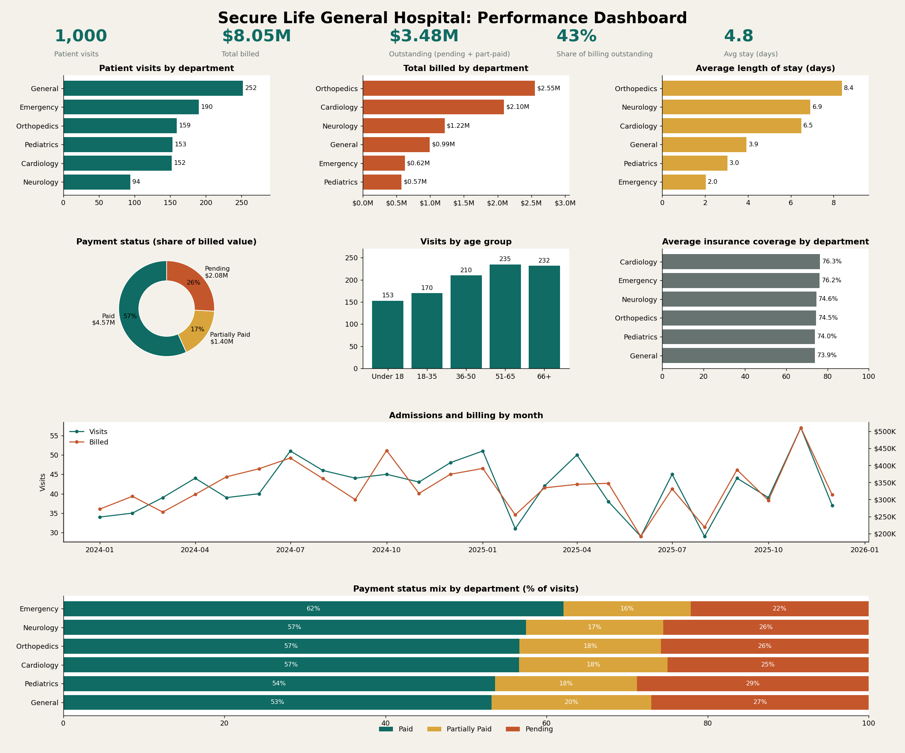

# Secure Life General Hospital: Patient Admissions & Billing Analysis

## Overview
Hospital management wanted a consolidated view of patient admissions,
billing and insurance coverage. This project cleans the raw data with
Power Query and presents the results in an interactive Excel dashboard.

## Dataset
- 1,000 patient visits, January 2024 to December 2025
- Each row is one visit, not one unique patient
- Columns: Patient ID, Patient Name, Age, Gender, Admission Date,
  Discharge Date, Department, Diagnosis, Total Bill Amount,
  Insurance Coverage %, Payment Status, Age Category

## Tools
- Microsoft Excel (PivotTables, PivotCharts, Slicers)
- Power Query

## Data Cleaning
- Set correct data types for dates, numbers, and text
- Trimmed text columns
- Filled 8 blank Age Category values with "66 & ABOVE"
  (all 8 patients were aged 66)
- Checked for duplicate Patient IDs (none found)
- Added columns: Length of Stay, Outstanding Amount, Patient Share
  Year, Month

## Key Questions Answered
1. Total patient visits
2. Departments with the most patients
3. Departments generating the highest bills
4. Average length of stay by department
5. Share of bills Paid, Pending and Partially Paid
6. Total billed vs outstanding
7. Insurance coverage by department and diagnosis
8. Age groups with the most visits
9. Admissions and billing over time
10. Areas needing management attention

## Key Findings
- 1,000 visits and about $8.05M billed
- About 43% of billed value is Pending or Partially Paid
- Orthopedics and Cardiology generate the most billing
- Orthopedics has the longest average stay (8.4 days)
- General has the most visits; Emergency has high volume but low
  revenue per visit
- 44 visits had no insurance coverage

## Assumptions
- "Outstanding" counts the full bill of every Pending and Partially
  Paid visit. It is an upper bound because the data does not show
  how much of a partial bill was paid.
- Length of stay = Discharge Date minus Admission Date.

## Dashboard

